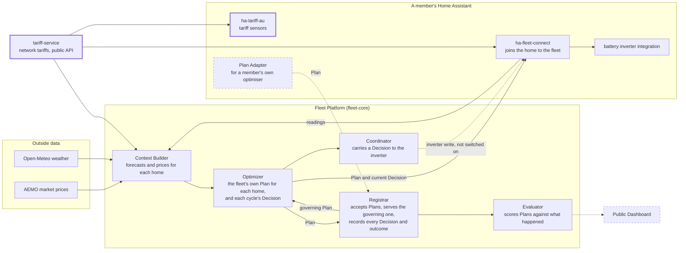

  

# Open Energy Collective

**Transparent. Cooperative. Battery aggregation for the Australian NEM.**

We're an Australian cooperative trying to create an ecosystem where home batteries can be viewed as a nation wide fleet no matter which provider is being used. Built for the people whose batteries make it possible - with every algorithm decision, fleet forecast, and outcome published for anyone to see.

## Principles

- **Transparent**: Every decision traceable. Fleet forecasts public.
- **Accountable**: Forecast accuracy tracked and published. Performance benchmarked publicly.
- **Source-Available, Becoming Open Source**: BSL 1.1 for Fleet Platform (converts to Apache-2.0 3 years after each release), MIT for tools. Built in the open; free for cooperatives, individuals, researchers, and non-commercial use from day one.

## How it fits together

Thick border: public repo. Dashed: not built or not switched on yet. Fleet Platform opens no connection to a home. The home pushes its readings and pulls its Plan.

| Part | What it does |
|---|---|
| Context Builder | Collects market prices, weather, network tariffs and each home's readings. Forecasts each home's solar and load. |
| Optimizer | Solves the fleet's own Plan for each home: when to charge, hold, export or self-supply. Each cycle it makes the home's Decision from the governing Plan. |
| Registrar | Accepts Plans from any registered producer and serves the governing Plan for each home: the newest valid Plan from the producer assigned to it, the fleet's own optimiser by default. Records every Plan, every Decision and what the home actually did. |
| Plan Adapters | A member's own optimiser can submit Plans for their home. They are recorded and scored alongside the fleet's, and govern the home once that producer is assigned to it. An adapter runs in the member's environment and reaches only the Registrar's Plans API. Specified, not built. |
| Evaluator | A separate service that reads only the Registrar and scores forecasts and Plans against outcomes. |
| Coordinator | Carries a Decision to the inverter and reads it back. Built, not switched on. |

## Repos

| Repo | What it is | Licence | State | Public |
|---|---|---|---|---|
| [tariff-service](https://github.com/Open-Energy-Collective/tariff-service) | Free REST API of Australian network tariffs | MIT | Live. 12 DNSPs, 105 tariffs | yes |
| [ha-tariff-au](https://github.com/Open-Energy-Collective/ha-tariff-au) | Network tariff sensors for Home Assistant | MIT | Released, in the Home Assistant Marketplace | yes |
| ha-fleet-connect | Home Assistant integration that joins a home to the fleet and shows its Plan | MIT | Running on the pilot. Sigenergy only | not yet |
| fleet-core | Fleet Platform: the parts above | BSL 1.1, Apache-2.0 after 3 years | Running on the pilot. Plans and records, does not control a battery | not yet |
| Public Dashboard, Member Portal | Fleet-wide and per-member views | BSL 1.1 | Not started | no |

fleet-core and ha-fleet-connect are private until their first public release. Ask for read access if you want to review the design or the code before then.

## What's next

- fleet-core: Plans verified against the dispatch ruleset, on a simulated home.
- ha-fleet-connect: a member's own Home Assistant automation can follow the Plan.
- tariff-service: a scheduled scan of DNSP price lists, and Ergon and TasNetworks coverage.

## Contribute

This is a cooperative, not a product launch. We want people in the conversation before decisions are locked in, not after.

- **Check your tariff.** Look up your network tariff in the [API](https://api.openenergy.org.au/docs) and open an issue in tariff-service if a rate, window or demand charge is wrong.
- **Add a DNSP or tariff.** Ergon and TasNetworks are not covered yet. Start from the DNSP's approved price list.
- **Run ha-tariff-au** on your Home Assistant and report what breaks.
- **Own a GoodWe or Sungrow battery on Home Assistant?** ha-fleet-connect finds Sigenergy entities today. Open a discussion with your inverter integration's entity list.
- **Run your own optimiser?** Plan Adapters are specified and not built. Open a discussion with the optimiser you run and the schedule format it outputs.
- **Review the design.** Ask for read access to fleet-core.
- Contact [@axilotl](https://github.com/axilotl) or open a discussion in any repo if you want to get involved
- [openenergy.org.au](https://openenergy.org.au)
- [API Docs](https://api.openenergy.org.au/docs)

---

*Open Energy Collective Pty Ltd (ACN 700 429 429). Queensland, Australia.*
